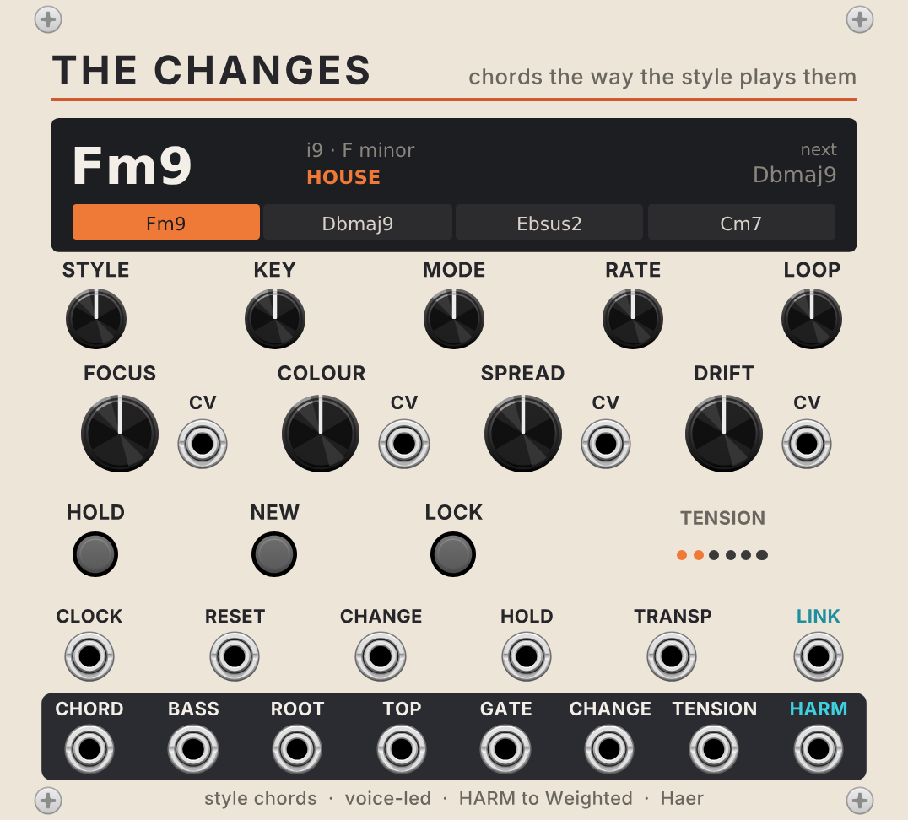

# Weighted

A VCV Rack 2 quantizer that picks notes by weight. Send it random CV and it
outputs notes in your chosen root and scale, but strong scale degrees come up
more often than weak ones, the way they do in real melodies.

A normal quantizer gives every scale note an equal slice of each volt.
Weighted makes each slice as wide as that note's weight. The weights come
from published scale-degree statistics (folk, classical and rock corpora,
listening experiments) or from the roles of tones in Javanese gamelan pathet.

## The display

- **Top line:** root and scale on the left, profile on the right.
- **Bars:** one per scale tone. The white bar is that tone's weight right now
  (Focus and Invert included); the note just played turns red. The thin red line is its weight on accented
  ("landing") notes. The blue mark is how often the tone actually came out in
  the last 256 notes, so you can watch the output match the weights.
- **Bottom line:** Focus value, Invert, mode, DRIFT and REL on the left; the last note,
  its weight and LAND (when it was an accented note) on the right. While
  learning it shows how many notes have been counted.
- **Draw your own weights:** click a bar and drag up or down to set that
  tone's weight. Dragging across the bars draws several at once. The first
  click copies the current weights into the User profile and switches Profile
  to User, so you start from what you hear and adjust it. (The weights you
  draw are what you hear at Focus 1; other Focus settings still sharpen or
  flatten them.)

## Knobs and buttons

| Control | What it does |
|---|---|
| **Root** | Home note, around the circle of fifths: C G D A E B F# Db Ab Eb Bb F, so each click clockwise adds a sharp (or removes a flat). Shown in the display |
| **Scale** | Major, natural minor, Dorian, Phrygian, Lydian, Mixolydian, harmonic minor, major and minor pentatonic, blues, chromatic, slendro, pelog (all 7 tones), pelog bem (1 2 3 5 6), pelog barang (2 3 5 6 7) |
| **Profile** | Where the weights come from (see below) |
| **Focus** | 0 = plain quantizer (all notes equal). 1 = the profile as published. Up to 3 = exaggerated, the strong notes take over. Weights are raised to this power |
| **Relative** | Same notes, new home: moves to the relative minor or major (C major becomes A minor, D Dorian becomes C major, F Lydian becomes A minor, major and minor pentatonic swap). The weights follow the new home. The display shows the key you hear. Harmonic minor goes to its relative major (its raised 7th drops back). No effect on blues, chromatic or the gamelan scales (the light glows dimly). The display shows REL while it's on |
| **Step** | Prefers small intervals: the further a note is from the last one, the less likely it is. Each note still plays as often as its weight; only the size of the jumps changes. Works when Trig is patched |
| **Range** | How many octaves the CV covers (1-5), from a root up to the root at the top, so 7 can step up to 1. The root's octave sits in the middle |
| **Length / Strong** | An internal accent cycle, used when Accent in is unpatched: every Length triggers, the step number set by Strong is a landing beat. Strong 0 = off. For gamelan, set Strong to the last step (4 of 4) |
| **Gravity** | Off = **Bins** mode: the whole CV range is re-weighted (higher CV still gives a higher note, so the contour survives). On = **Gravity** mode: CV is read as pitch, quantized to the nearest note, then sometimes pulled to a stronger note within 3 semitones. Focus sets how often (always at Focus 2 and above) |
| **Invert** | Flips the hierarchy: rare notes become common |
| **Octave** | -3 to +3 octaves on V/Oct. The last change before the pitch leaves the module (after root, range and chord) |
| **Mod A, Mod B** | Two assignable CV inputs. Each has an **amt** knob (attenuverter, default 100%) and a **dest** button that steps through Root, Scale, Rel, Profile, Focus and Pull. The display's top line shows where each goes (bright when patched). Both on the same destination add together. Also settable from the right-click menu |
| **Pull** | How much the chord at **Harm** in counts (attenuverter, default +50%). Right of noon: the chord's notes are chosen more often, up to 4 times as often at full, so the melody sits on the harmony. Noon: no effect. Left of noon: the chord's notes become rarer (a quarter as often at full), so the melody favours the notes between them for a tense, floating sound. With Harm unpatched it does nothing |
| **Learn** | Press, play some notes into CV in (with Trig patched, or by moving the CV), press again. At least 8 notes. The counts become the User profile and Profile switches to User |

## Profiles

| Profile | Source |
|---|---|
| Flat | None: an ordinary quantizer |
| Perceived fit | Krumhansl & Kessler (1982), listeners' ratings of how well each tone fits a key |
| Folk melody | Aarden (2003), note counts from the Essen folk song collection |
| Classical | Albrecht & Shanahan (2013), classical scores |
| Classical downbeats | Prince & Schmuckler (2014), notes on downbeats only |
| Rock melody | Temperley & de Clercq (2013), vocal melodies of 200 rock songs |
| Detroit Dorian | Designed: 1 strongest, then b3 and 5, b7, with 2 4 6 as colour |
| House | Designed: Dorian/minor, 1 b3 5 b7 with the 9th (2) as colour. Try Dorian scale |
| Gospel | Designed: major, 1 3 5 then 6 2 4, a little blue b3 and b7. Try Major or Chromatic |
| Funk | Designed: one-chord vamp, 1 b7 b3 5, with the major 3rd rubbing against b3. Try Blues, Dorian or Chromatic |
| Soul | Designed: major pentatonic core (1 5 3 6 2) with b3 and b7 bending in. Try Major or Chromatic |
| Reggae | Designed: major pentatonic, bass-led, few 4s and 7s. Try Major; for a "one drop" feel set Length 4, Strong 3 |
| Pathet 1, 2, 3 | Designed from the stressed, strong and avoided tones of each pathet. On slendro: nem, sanga, manyura. On pelog: lima, nem, barang |
| User | Learned with the Learn button |

No published note counts exist for house, gospel, funk, soul or reggae, so those five are designed from the rock data and each style's habits. Their exact weights are in `src/WeightedEngine.hpp`. The published profiles each have a major and a minor version. Weighted uses
the minor one when the scale has a minor third and no major third. Any
profile works on any scale: weights are matched by pitch.

## Jacks

| Jack | What it does |
|---|---|
| **CV** in | The voltage to quantize. Polyphonic: each channel is its own melody. Bins mode adapts to your CV's range by default (Auto); right-click for fixed -5 to +5 V, 0-10 V or 0-5 V. Gravity mode reads it as 1 V/oct pitch |
| **Trig** in | Takes a new note on each trigger. Unpatched: follows CV continuously |
| **Accent** in | High (above 1 V) when a note is taken = use the landing weights (the two strongest tones boosted) |
| **Mod A**, **Mod B** in | Assignable (see above). As Root: 1 V/oct, rounded to semitones, added to the Root knob. As Scale or Profile: 10 V sweeps the whole list. As Rel: a gate, high (above 1 V) flips the Relative switch, so a sequencer can change the mood per section. As Focus: 10 V moves Focus across its whole range. Patches from before 2.4.0 load with Mod A on Root and Mod B on Scale (where those jacks were); cables in the old Profile, Focus and Rel jacks need re-patching |
| **Harm** in | A chord to lean on (polyphonic, 1 V/oct). Any poly chord works, with channel 1 as the chord's root: up to 6 notes are read. Pull sets how much it counts, the chord's notes show an amber line under their bars, and the light by the jack glows. When the chord changes (and Pull is above noon), the next note lands on the new chord's root or 3rd: the light flashes bright. With **Chord on V/Oct** on, the added notes are the chord's own (next chord tone up, and the one after) instead of scale thirds. From the Changes module, the cable (10 or more channels) also sets Weighted's key, mode and profile, shown as HARM in the display's top line (right-click to keep your own knobs instead). Channel layout: 1-6 chord notes (1 = root), 7 how many of them (1 V each), 8 key root (1/12 V per semitone above C), 9 mode (0 V major, 1 V minor, 2 V Dorian, 3 V Mixolydian), 10 profile (0.5 V per profile, in the Profile knob's order), 11 chord-change trigger |
| **V/Oct** out | The note. With Root on C and Octave at 0, the root's middle octave is at 0 V (C4) |
| **Trig** out | A 1 ms trigger for each new note (right-click: only when the pitch changes) |
| **Degree** out | Which scale tone was chosen, 1 V per step, first tone = 0 V |
| **Stability** out | 0-10 V: how strong the chosen note is (10 V = the strongest tone). Patch it to a filter, VCA or decay so landing notes sound brighter, louder or longer |

## Right-click menu

- CV input range for Bins mode: Auto (the default; follows the lowest and highest CV seen recently), -5 to +5 V, 0-10 V or 0-5 V
- No-repeat (off, low, medium, high): makes the same note twice in a row less likely
- Landing boost: how much accented notes favour the two strongest tones (x1.5, x2, x3)
- Trigger output: every new note, or only pitch changes
- **Phrase ending:** the last step of the accent cycle (set by Length) always
  lands home, on the first scale tone or on the strongest tone (best for
  gamelan scales, where the first tone may not be the strongest). Gives loops
  a sense of closure. Works with Trig patched
- **Drift:** each tone's weight wanders slowly on its own (slow, about a
  minute; medium, about 20 s; fast, about 5 s), between roughly a third and
  nearly three times its normal weight. The pattern keeps its character but
  its balance keeps shifting. The display shows DRIFT and the bars move
- **Relative changes:** at once, or at the end of the accent cycle (set by Length), so a gate that arrives mid-phrase changes the key when the next phrase starts. The Relative light blinks while a change is waiting. Works with Trig patched
- **Chord on V/Oct:** V/Oct (and Trig) become polyphonic and add the 3rd, the
  3rd and 5th, or the 5th above each note, counted in scale steps, so chords
  always stay in the scale. Patch V/Oct to a polyphonic voice. With
  polyphonic CV in, channels are limited so the total stays at 16
- **HARM input:** key, mode and profile follow the Changes cable (default), or keep your own knobs
- Gamelan tuning: the slendro/pelog tuning (default or loaded), or snap to 12-TET
- Load a Scala tuning (.scl): 5 notes per octave replaces slendro, 7 replaces pelog
- Clear the User profile

## The Changes

The second module in this plugin (28 HP). A chord sequencer that picks the
next chord the way a player of the chosen style would, with that style's
usual extensions, and voice-leads it. Patch its **HARM** output into
Weighted's **HARM** input and Weighted's melody follows the chords.

| Control | What it does |
|---|---|
| Display | The chord now (name, Roman numeral, key), the next chord, and the loop. An amber dot marks a chord DRIFT rewrote. Click a chord to roll it again; right-click to choose one from the style's list |
| **Style** | Weighted's profile list: Flat, Fit, Folk, Classical, Downbeat, Rock, Detroit, House, Gospel, Funk, Soul, Reggae, Pathet 1-3 (a drone on the pathet's main tones) |
| **Key** | Circle of fifths, like Weighted's Root |
| **Mode** | Style (each style's home key, default), major, minor, Dorian, Mixolydian |
| **Rate** | Bars per chord when clocked: 1/2, 1, 2, 4, 8 |
| **Loop** | Off (a new chord every time), 2, 4 or 8 chords |
| **Focus** + CV | 0 = any chord in the key, 1 = the style as written, 3 = only its favourite moves |
| **Colour** + CV | How far up the chord goes: triad, 7th, 9th, 11th, 13th, within what the style uses (a reggae I stays a triad) |
| **Spread** + CV | Close voicing to drop-2 to wide |
| **Drift** + CV | Chance that one chord of the loop (never the first) is rewritten after each pass |
| **Hold** (button and gate) | Stay on this chord |
| **New** | A fresh loop on the next bar line |
| **Lock** | No drift edits |

Styles at a glance: Folk I IV V vi with sus and add9; Classical home, away,
dominant, home, with 7ths on V and ii and inversions in the bass; Rock I bVII
IV and power chords at low Colour; Detroit two-chord minor vamps with m9 and
m11; House i bVI bVII and i iv with m9 and maj9; Gospel ii V I, IV #iv dim7 I
and secondary dominants with 9ths and 13ths; Funk a dominant 9 or 13 vamp
stepping to IV7; Soul maj7 and m9 with ii V; Reggae plain triads.

**Inputs:** CLOCK (16ths; right-click for 24 PPQN, 8ths or quarters), RESET,
CHANGE (next chord now, or on the next beat), HOLD, TRANSP (1 V/oct, rounded),
LINK (from Long Form: changes on its bar lines, keeps a separate loop for each
section, and Long Form's energy adds Colour and tension). With no clock, only
CHANGE moves on.

**Outputs:** CHORD (poly, Voices: Auto by style or 3-6), BASS (C2-B2), ROOT,
TOP (highest voice), GATE (with a 5 ms gap at each change), CHANGE, TENSION
(0-10 V: home 0 V, dominants and passing chords high), HARM (to Weighted).

Right-click: voices, bass inversions, clock rate, Change timing, what Long Form
energy drives, restore this loop (undo drift), new loops for every section.

## Gamelan tunings

Every gamelan set is tuned differently, so the defaults are only rough guides:
slendro as five equal steps of 240 cents, pelog as a subset of 9-tone equal
temperament (steps of about 133 and 267 cents, large steps between 3-4 and
7-1). Load a Scala file of a real gamelan for a better match, or choose
"Snap to 12-TET" to play with Western gear.

## Building

GitHub Actions tests the engine and builds the Apple Silicon version on every
push to main (see `.github/workflows/build.yml`). The `.vcvplugin` file appears
on this repository's **latest** release page. To build locally, download the
Rack SDK and run `make dist RACK_DIR=/path/to/Rack-SDK`.

The panels are drawn by `res/make_panel.py` and `res/make_changes_panel.py` (needs `pip install fonttools`). The
engine (`src/WeightedEngine.hpp`) has no Rack dependencies.
`test/engine_test.cpp` checks it offline: output counts match the weights,
contour is kept, Focus, Invert, landing weights, gamelan pathet and tunings,
Gravity, Step (including that it keeps note counts equal to the weights and lets 7 step up to 1), No-repeat, the User profile, Scala parsing, relative keys and the circle-of-fifths Root knob.
`test/changes_test.cpp` checks The Changes' engine: every style, mode and colour, chord names, Focus, loops, drift and voice leading.
