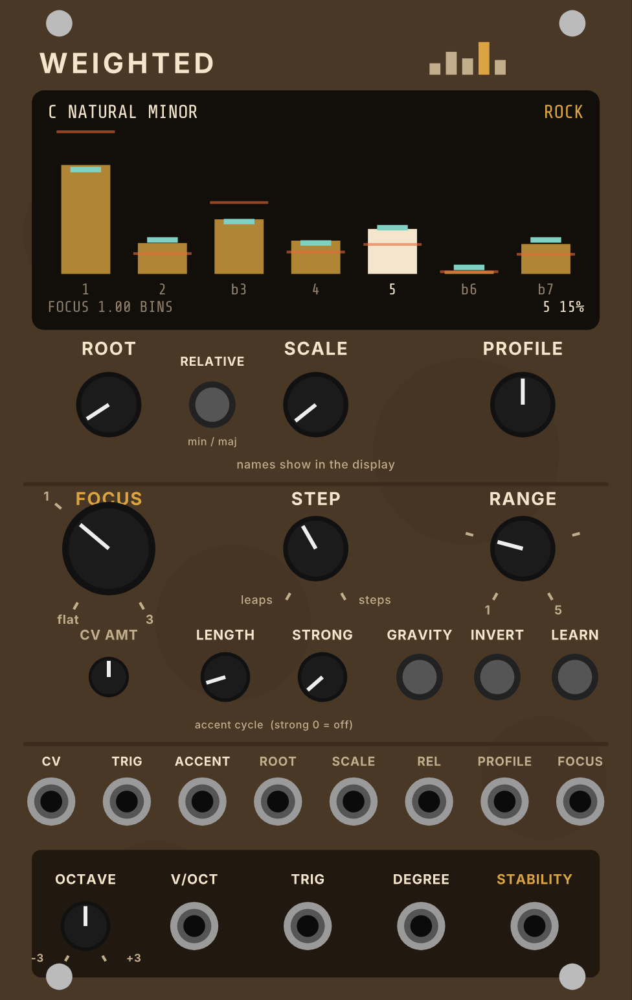

# Weighted

A VCV Rack 2 quantizer that picks notes by weight. Send it random CV and it
outputs notes in your chosen root and scale, but strong scale degrees come up
more often than weak ones, the way they do in real melodies.

A normal quantizer gives every scale note an equal slice of each volt.
Weighted makes each slice as wide as that note's weight. The weights come
from published scale-degree statistics (folk, classical and rock corpora,
listening experiments) or from the roles of tones in Javanese gamelan pathet.

## The display

- **Top line:** root and scale on the left, profile on the right.
- **Bars:** one per scale tone. The gold bar is that tone's weight right now
  (Focus and Invert included). The thin orange line is its weight on accented
  ("landing") notes. The teal mark is how often the tone actually came out in
  the last 256 notes, so you can watch the output match the weights.
- **Bottom line:** Focus value, Invert and mode on the left; the last note,
  its weight and LAND (when it was an accented note) on the right. While
  learning it shows how many notes have been counted.
- **Draw your own weights:** click a bar and drag up or down to set that
  tone's weight. Dragging across the bars draws several at once. The first
  click copies the current weights into the User profile and switches Profile
  to User, so you start from what you hear and adjust it. (The weights you
  draw are what you hear at Focus 1; other Focus settings still sharpen or
  flatten them.)

## Knobs and buttons

| Control | What it does |
|---|---|
| **Root** | Home note, around the circle of fifths: C G D A E B F# Db Ab Eb Bb F, so each click clockwise adds a sharp (or removes a flat). Shown in the display |
| **Scale** | Major, natural minor, Dorian, Phrygian, Lydian, Mixolydian, harmonic minor, major and minor pentatonic, blues, chromatic, slendro, pelog (all 7 tones), pelog bem (1 2 3 5 6), pelog barang (2 3 5 6 7) |
| **Profile** | Where the weights come from (see below) |
| **Focus** | 0 = plain quantizer (all notes equal). 1 = the profile as published. Up to 3 = exaggerated, the strong notes take over. Weights are raised to this power |
| **CV amt** | Attenuverter for the Focus CV input. 10 V moves Focus across its whole range |
| **Relative** | Same notes, new home: moves to the relative minor or major (C major becomes A minor, D Dorian becomes C major, F Lydian becomes A minor, major and minor pentatonic swap). The weights follow the new home. The display shows the key you hear. No effect on harmonic minor, blues, chromatic or the gamelan scales (the light glows dimly) |
| **Step** | Prefers small intervals: the further a note is from the last one, the less likely it is. Each note still plays as often as its weight; only the size of the jumps changes. Works when Trig is patched |
| **Range** | How many octaves the CV covers (1-5), from a root up to the root at the top, so 7 can step up to 1. The root's octave sits in the middle |
| **Length / Strong** | An internal accent cycle, used when Accent in is unpatched: every Length triggers, the step number set by Strong is a landing beat. Strong 0 = off. For gamelan, set Strong to the last step (4 of 4) |
| **Gravity** | Off = **Bins** mode: the whole CV range is re-weighted (higher CV still gives a higher note, so the contour survives). On = **Gravity** mode: CV is read as pitch, quantized to the nearest note, then sometimes pulled to a stronger note within 3 semitones. Focus sets how often (always at Focus 2 and above) |
| **Invert** | Flips the hierarchy: rare notes become common |
| **Octave** | -3 to +3 octaves on V/Oct. The last change before the pitch leaves the module (after root, range and chord) |
| **Learn** | Press, play some notes into CV in (with Trig patched, or by moving the CV), press again. At least 8 notes. The counts become the User profile and Profile switches to User |

## Profiles

| Profile | Source |
|---|---|
| Flat | None: an ordinary quantizer |
| Perceived fit | Krumhansl & Kessler (1982), listeners' ratings of how well each tone fits a key |
| Folk melody | Aarden (2003), note counts from the Essen folk song collection |
| Classical | Albrecht & Shanahan (2013), classical scores |
| Classical downbeats | Prince & Schmuckler (2014), notes on downbeats only |
| Rock melody | Temperley & de Clercq (2013), vocal melodies of 200 rock songs |
| Detroit Dorian | Designed: 1 strongest, then b3 and 5, b7, with 2 4 6 as colour |
| House | Designed: Dorian/minor, 1 b3 5 b7 with the 9th (2) as colour. Try Dorian scale |
| Gospel | Designed: major, 1 3 5 then 6 2 4, a little blue b3 and b7. Try Major or Chromatic |
| Funk | Designed: one-chord vamp, 1 b7 b3 5, with the major 3rd rubbing against b3. Try Blues, Dorian or Chromatic |
| Soul | Designed: major pentatonic core (1 5 3 6 2) with b3 and b7 bending in. Try Major or Chromatic |
| Reggae | Designed: major pentatonic, bass-led, few 4s and 7s. Try Major; for a "one drop" feel set Length 4, Strong 3 |
| Pathet 1, 2, 3 | Designed from the stressed, strong and avoided tones of each pathet. On slendro: nem, sanga, manyura. On pelog: lima, nem, barang |
| User | Learned with the Learn button |

No published note counts exist for house, gospel, funk, soul or reggae, so those five are designed from the rock data and each style's habits. Their exact weights are in `src/WeightedEngine.hpp`. The published profiles each have a major and a minor version. Weighted uses
the minor one when the scale has a minor third and no major third. Any
profile works on any scale: weights are matched by pitch.

## Jacks

| Jack | What it does |
|---|---|
| **CV** in | The voltage to quantize. Polyphonic: each channel is its own melody. Bins mode adapts to your CV's range by default (Auto); right-click for fixed -5 to +5 V, 0-10 V or 0-5 V. Gravity mode reads it as 1 V/oct pitch |
| **Trig** in | Takes a new note on each trigger. Unpatched: follows CV continuously |
| **Accent** in | High (above 1 V) when a note is taken = use the landing weights (the two strongest tones boosted) |
| **Root** in | 1 V/oct, rounded to semitones, added to the Root knob |
| **Scale**, **Profile** in | 10 V sweeps the whole list, added to the knob |
| **Focus** in | Scaled by CV amt |
| **Rel** in | Gate: high (above 1 V) flips the Relative switch, so a sequencer can change the mood per section |
| **V/Oct** out | The note. With Root on C and Octave at 0, the root's middle octave is at 0 V (C4) |
| **Trig** out | A 1 ms trigger for each new note (right-click: only when the pitch changes) |
| **Degree** out | Which scale tone was chosen, 1 V per step, first tone = 0 V |
| **Stability** out | 0-10 V: how strong the chosen note is (10 V = the strongest tone). Patch it to a filter, VCA or decay so landing notes sound brighter, louder or longer |

## Right-click menu

- CV input range for Bins mode: Auto (the default; follows the lowest and highest CV seen recently), -5 to +5 V, 0-10 V or 0-5 V
- No-repeat (off, low, medium, high): makes the same note twice in a row less likely
- Landing boost: how much accented notes favour the two strongest tones (x1.5, x2, x3)
- Trigger output: every new note, or only pitch changes
- **Phrase ending:** the last step of the accent cycle (set by Length) always
  lands home, on the first scale tone or on the strongest tone (best for
  gamelan scales, where the first tone may not be the strongest). Gives loops
  a sense of closure. Works with Trig patched
- **Drift:** each tone's weight wanders slowly on its own (slow, about a
  minute; medium, about 20 s; fast, about 5 s), between roughly a third and
  nearly three times its normal weight. The pattern keeps its character but
  its balance keeps shifting. The display shows DRIFT and the bars move
- **Chord on V/Oct:** V/Oct (and Trig) become polyphonic and add the 3rd, the
  3rd and 5th, or the 5th above each note, counted in scale steps, so chords
  always stay in the scale. Patch V/Oct to a polyphonic voice. With
  polyphonic CV in, channels are limited so the total stays at 16
- Gamelan tuning: the slendro/pelog tuning (default or loaded), or snap to 12-TET
- Load a Scala tuning (.scl): 5 notes per octave replaces slendro, 7 replaces pelog
- Clear the User profile

## Gamelan tunings

Every gamelan set is tuned differently, so the defaults are only rough guides:
slendro as five equal steps of 240 cents, pelog as a subset of 9-tone equal
temperament (steps of about 133 and 267 cents, large steps between 3-4 and
7-1). Load a Scala file of a real gamelan for a better match, or choose
"Snap to 12-TET" to play with Western gear.

## Building

GitHub Actions tests the engine and builds the Apple Silicon version on every
push to main (see `.github/workflows/build.yml`). The `.vcvplugin` file appears
on this repository's **latest** release page. To build locally, download the
Rack SDK and run `make dist RACK_DIR=/path/to/Rack-SDK`.

The panel is drawn by `res/make_panel.py` (needs `pip install fonttools`). The
engine (`src/WeightedEngine.hpp`) has no Rack dependencies.
`test/engine_test.cpp` checks it offline: output counts match the weights,
contour is kept, Focus, Invert, landing weights, gamelan pathet and tunings,
Gravity, Step, No-repeat, the User profile and Scala parsing.
